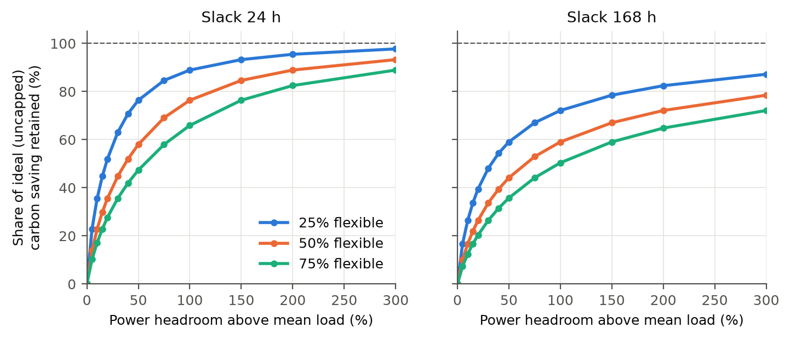

# carbonshift: carbon-aware workload shifting under facility power limits

[](https://github.com/lakkaramnaveen/carbonshift/actions/workflows/tests.yml)

This repository holds a clean-room **reproduction** of Sukprasert, Souza, Bashir, Irwin & Shenoy, *"On the Limitations of Carbon-Aware Temporal and Spatial Workload Shifting in the Cloud"* (EuroSys 2024, [arXiv:2306.06502](https://arxiv.org/abs/2306.06502)). It then asks what the data-centre facility itself allows. The first two **extensions** are:

1. **Power headroom.** All shifted work must fit under the facility's power rating, which is set by the utility service, transformers, UPS and generators. How much of the ideal carbon saving survives?
2. **LLM inference energy against batch size, measured** on an Apple M4 Pro GPU. How many tokens per joule does each extra watt of headroom buy?

Full write-up: **[docs/REPORT.md](docs/REPORT.md)**. Research paper (Word): **[carbonshift_paper.docx](carbonshift_paper.docx)**, generated from the result CSVs by `scripts/build_paper.py`. One-page summary (PDF): **[carbonshift_summary.pdf](carbonshift_summary.pdf)**, from `scripts/build_summary.py`.

## Headline results

**Reproduction.** 27 of 30 numeric claims match within about 1 g·CO₂eq, 0.6 percentage points, or 3% (`results/repro_vs_paper.csv`); the "< 10 g" bound also holds. The gaps are explained in the report: one is an internal inconsistency in the paper, one a spatial-metric edge case, and two are statistics whose stated definitions don't match. Examples:

| | Paper | Reproduced |
|---|---:|---:|
| Deferral, 1 h → 168 h jobs, 1-yr slack (g/job-h) | 154 → 70 | 153.9 → 69.9 |
| Deferral, 24 h slack | 57 → 3 | 57.4 → 2.9 |
| Spatial, infinite capacity / 50% idle (g) | 352 / 190 | 352.5 / 189.7 |
| Latency SLO 50 ms at 50% utilisation | 31% | 31.1% |

**Extension 1, facility power headroom.** These are global means over 123 zones, with 50% of the load flexible and 24 h slack:

- The ideal ("uncapped") saving needs the median facility to draw **13× its mean power** in a single hour, and **85×** with weekly slack.
- **20% headroom keeps 36%** of the ideal saving, 50% keeps 58%, and 100% keeps 76%.
- The median zone needs **+34% headroom to keep half** the ideal saving and **+125% to keep 80%**.
- A 10-minute UPS battery, cycled daily, cuts emissions by **0.19%**.

**Extension 2, GPU power against LLM batch size** (Apple M4 Pro, MLX, measured with `macmon`):

| Model | Batch 1 | Batch 32 | Batch 128 |
|---|---:|---:|---:|
| Qwen2.5-1.5B 4-bit: tokens/s, chip mJ/token | 198, 99 | 1,292, **23** | 1,392, 23 |
| Qwen2.5-7B 4-bit: tokens/s, chip mJ/token | 53, 377 | 318, **100** | 326, 101 |

Going from batch 1 to batch 32 raises throughput 6.5× for only 1.5× more power. Past batch 32 the GPU saturates at 31–32 W.

**Extension 3, the carbon price of a kilowatt.** The LP's dual variables give the CO₂ that one more kW of headroom saves each year. For the median zone at 20% headroom that is 228 kg/yr. Embodied-carbon factors derived from manufacturer EPDs show what headroom is worth building:
- **Electrical plant:** repays its embodied carbon within a year in 94–98% of zones.
- **CPU servers bought just to absorb shifted work:** pay back within a server's life in only 23% of zones.

**Build power, not servers.** Tier redundancy (the N+1 or 2N spare) is free carbon headroom. Using it closes 36–73% of the gap to the ideal saving, and maintenance and failures cost under 0.01 percentage points.

**Robustness.** All facility findings hold for 2020, 2021 and 2022. The carbon value of a kW of headroom rose 17% over those years. Every finding is tracked in [docs/RESEARCH_LOG.md](docs/RESEARCH_LOG.md).

**Further findings** (F11–F19 in the log):

- **Real utilisation.** Google's PowerData2019 domains run at a median 70% of capacity (+42% headroom), which keeps **54%** of the ideal saving. The daily load shape barely matters.
- **Forecast error** (5–15% MAPE) and power caps compound almost independently.
- **What sets the value of capacity is the grid's absolute daily swing, not its level.** Shadow price vs daily std: Spearman 0.993; predictor ≈ 4.83·σ^1.12 kg/kW-yr (R² 0.96). Affine invariance is proved and tested.
- **Marginal signals** (EIA-930, 48 US balancing authorities): a schedule optimised on the *average* signal captures only 7% of the marginal-optimal saving and *raises* marginal emissions in 44% of BAs. **Blending the two signals is nearly free:** scheduling on 0.7·average + 0.3·marginal keeps 78% of the average and 79% of the marginal optimum (F19).
- **Siting.** Spatial and temporal flexibility want capacity in opposite places (rank correlation −0.39 to −0.15 across 32 GCP regions), and under real per-region caps they compete for the same headroom: temporal shifting adds under 1 pp on top of migration.
- **Carbon-aware LLM batching** adds only 1.6–4.8% over static batching at the efficient size, which already cuts CO₂ 41–71% versus batch 1.
- **Uncertainty.** "Build power, not servers" holds in 100% of 5,000 Monte Carlo draws over EPD ranges.



## Interactive explorer

Every model in this project has knobs you can turn in the browser:

```bash
.venv/bin/pip install -e ".[web]"
.venv/bin/carbonshift-web            # then open http://127.0.0.1:8000
```

It has six tabs: **Grid shifting** (job length and slack), **Facility headroom** (flexible share, slack, power cap, and a week-by-week schedule), **UPS battery** (size, reserve, efficiency), **LLM on GPU** (model, batch, grid region, daily volume), **Build or not?** (design utilisation, N+1 / 2N redundancy, what you would build: value of +1 kW and embodied payback) and **Siting** (32 GCP regions ranked by spatial vs temporal value of capacity).

**Security design.** The service is read-only and compute-only. It stores no user data and needs no secrets.

| Concern | Control |
|---|---|
| Malformed or abusive input | Strict Pydantic models (`extra="forbid"`). Zones are checked against the dataset, and every knob is a bounded range or a fixed set, so no request can trigger an unbounded computation. |
| Resource exhaustion | Per-client token-bucket rate limit (HTTP 429 + `Retry-After`), a cap on concurrent computations (HTTP 503), a 4 KiB body limit including chunked uploads (HTTP 413), and LRU-cached results. |
| XSS and clickjacking | CSP `default-src 'self'` with no inline script or style, `frame-ancestors 'none'`, `X-Frame-Options: DENY`, `nosniff`. The UI writes data only through `textContent`. |
| Host and origin attacks | TrustedHost allow-list (default `127.0.0.1,localhost`). CORS is off unless origins are configured. |
| Information leaks | Generic JSON errors with no stack traces, no `Server` header, OpenAPI docs off by default, `Cache-Control: no-store` on the API, `Referrer-Policy: no-referrer`. |
| GPU abuse | The API serves pre-measured LLM results and never runs inference. |
| Exposure | Binds to `127.0.0.1` by default. To publish it, put it behind a TLS reverse proxy and set `CARBONSHIFT_ALLOWED_HOSTS`. HSTS is sent automatically over HTTPS. |

Settings: `CARBONSHIFT_ALLOWED_HOSTS`, `CARBONSHIFT_CORS_ORIGINS`, `CARBONSHIFT_RATE_PER_MIN` (default 120), `CARBONSHIFT_MAX_CONCURRENT` (4), `CARBONSHIFT_ENABLE_DOCS` (0). These behaviours are covered by `tests/test_web.py`.

## Layout

```
src/carbonshift/
  data.py              load traces + region groupings (preprocessing identical to the artifact)
  temporal.py          deferral / interruption upper bounds (vectorised; tested against the original loop)
  spatial.py           capacity-, latency-constrained migration; 1- vs inf-migration
  facility.py          power-capped shifting LP (cumulative-flow form, hourly caps, shadow prices) + battery LP
  spatial_capacity.py  hourly migration LP under per-region caps; joint spatial + temporal LP
  embodied.py          EPD-derived embodied carbon per kW: transformers, UPS, generators, servers (cited)
  redundancy.py        N+1 / 2N topologies, maintenance + failure windows, carbon-aware maintenance
  forecast.py          MAPE-calibrated AR(1) forecast errors and the regret they cause
  google_power.py      Google PowerData2019 loader (real utilisation and load shapes)
  eia930.py            EIA-930 average and marginal (Siler-Evans) emission signals
  hedge.py             average-vs-marginal Pareto frontier via blended objectives
  llm_batching.py      static vs carbon-aware batching under a latency budget (Lagrangian, LP-checked)
  power.py             sudo-free Apple Silicon power sampling via macmon
  plotting.py          shared figure style (colour-blind-validated palette)
  web/                 secure FastAPI explorer API + dependency-free responsive UI (static/)
scripts/
  reproduce.py                 all paper figures/claims -> results/repro_*.csv, figures/repro_*.png
  facility_experiments.py      headroom x flexibility x slack sweep, battery sweep
  llm_power_batch.py           GPU power / throughput / energy per token vs batch size (MLX)
  redundancy_experiments.py    shadow price of capacity, embodied payback, redundancy dividend
  robustness_years.py          re-run facility findings on 2020 / 2021 / 2022 traces
  forecast_experiments.py      forecast error x power cap
  diurnal_load_experiments.py  real Google utilisation and load shapes
  siting_experiments.py        spatial vs temporal value of capacity across GCP regions
  llm_batching_experiments.py  carbon-aware batching across 120 grids
  variability_drivers.py       what drives the value of capacity (swing vs level)
  embodied_uncertainty.py      Monte Carlo over embodied-carbon factors
  marginal_experiments.py      average vs marginal signals (EIA-930)
  joint_experiments.py         spatial + temporal shifting under per-region caps
  hedge_experiments.py         blend average and marginal signals (Pareto frontier)
  build_paper.py               generate carbonshift_paper.docx from results/*.csv
  build_summary.py             generate the one-page carbonshift_summary.pdf
tests/          70 tests: reference-loop and brute-force-LP equivalence, invariants, API behaviour and security
data/           carbon traces + metadata (see data/README.md for sources and licences)
results/        every number in the report, as CSV
figures/        every figure in the report
docs/REPORT.md  the write-up
```

## Run it

```bash
python3 -m venv .venv && .venv/bin/pip install -e ".[dev,web]"
.venv/bin/python -m pytest                              # 70 tests, ~3 s
.venv/bin/python scripts/reproduce.py                   # ~20 s
.venv/bin/python scripts/facility_experiments.py        # ~80 s on 14 cores
.venv/bin/python scripts/redundancy_experiments.py      # ~2 min
# GPU experiment (Apple Silicon only):
brew install macmon && .venv/bin/pip install mlx mlx-lm
.venv/bin/python scripts/llm_power_batch.py             # ~20 min; downloads two Qwen2.5 MLX models
```

## Credits

Method and data: Sukprasert et al., EuroSys'24 and their [artifact](https://github.com/umassos/decarbonization-potential). Carbon data © Electricity Maps (ODbL). The original artifact code was read for reference but not executed; everything in `src/` is a clean re-implementation.
