# Carbon-Aware Workload Shifting Meets the Facility's Power Limit

**A reproduction of Sukprasert, Souza, Bashir, Irwin & Shenoy, "On the Limitations of Carbon-Aware Temporal and Spatial Workload Shifting in the Cloud" (EuroSys 2024), extended with facility power-capacity and UPS-battery limits and with GPU power measured against LLM batch size.**

Naveen Lakkaram · November 2026 · code and data: this repository (`scripts/reproduce.py`, `scripts/facility_experiments.py`)

---

## 1. Motivation

Sukprasert et al. bound the carbon saved by moving cloud work in **time** (deferring or pausing jobs into low-carbon hours) and **space** (migrating work to greener regions). They use hourly Electricity Maps traces for 123 grid zones. Their central message is that the practical savings are far below the ideal. The spatial analysis already applies capacity limits, but the temporal analysis treats each job alone and so lets every job fall into the same low-carbon hours. The authors name this gap themselves (§5.2.5, "resource constraints that prevent running many jobs during low carbon periods").

A data centre is an electrical facility before it is a computer. Its grid draw is bounded by the utility service, the substation transformers, switchgear, the UPS rating with N+1 or 2N redundancy, and the generator plant sized to back it up. This project asks:

> **How much of the ideal temporal carbon saving survives once all shifted work must fit under the facility's power rating? And can the UPS batteries a facility already owns shift carbon on their own?**

## 2. Reproduction

I re-implemented the analysis from scratch: vectorised NumPy, about 20 s for every figure on a laptop instead of a 50-process loop. I ran it on the authors' released 2022 traces. A unit test checks my temporal code against a line-by-line port of the artifact's loop, so edge handling matches exactly: windows are clipped at the end of the year, and "one-year slack" means "until the end of the year".

**Result: 27 of 30 numeric claims reproduce.** Each lands within about 1 g·CO₂eq, 0.6 percentage points, or 3% of the stated value. The single "< 10" bound is also met (`results/repro_vs_paper.csv`):

| Claim | Paper | Reproduced |
|---|---:|---:|
| Global mean carbon intensity (g/kWh) | 368.39 | 368.38 |
| Deferral, 1 h → 168 h job, 1-year slack (g/job-h) | 154 → 70 | 153.9 → 69.9 |
| Deferral, 1 h → 168 h job, 24 h slack | 57 → 3 | 57.4 → 2.9 |
| Extra from interruption, 168 h job, 1-yr slack | 43 | 42.5 |
| Interruption peak (24 h job, 24 h slack) | 18.4 | 18.4 |
| Equal / Azure / Google job mix, 1-yr slack | 135 / 100 / 112 | 134.9 / 100.6 / 111.9 |
| Spatial, infinite capacity (Global / Europe / Asia) | 352 / 281 / 556 | 352.5 / 281.2 / 555.8 |
| Spatial, 50% idle capacity (Global) | 190 | 189.7 |
| Global reduction at 50% / 99% idle | 51.5% / 95.68% | 51.50% / 95.68% |
| Latency SLO 250 ms, infinite / 50% util. | 92.5% / 45.7% | 92.5% / 45.5% |
| Latency SLO 50 ms, 50% utilisation | 31% | 31.1% |
| 1-migration vs ∞-migration gap | < 10 g | ≤ 7.9 g |

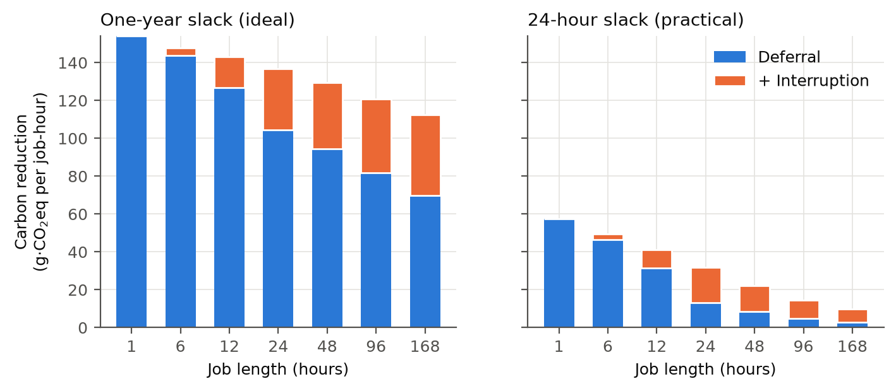

**Three observations from the reproduction:**

1. **Fig. 10d, 1-year slack (127 g)** is the same quantity as Fig. 10a's equal-mix value (135 g). The artifact code computes both identically and gives 134.9, so the 127 likely comes from an earlier run.
2. **Two §1/§4 statistics don't match the stated definitions.** The share of zones with daily CV < 0.1 is 49.6%, not "> 70%"; the threshold CV < 0.15 gives 74%. The max/min mean-intensity ratio is 60× across all zones and 51× across cloud zones, not 40×. Neither changes any conclusion.
3. **Spatial metric for groups whose work all leaves the group.** The artifact computes a group's reduction as its mean intensity minus the mean of member DCs that receive work. When no member receives work, that term becomes 0 (`NaN → 0`), as if the work landed somewhere zero-carbon. For Asia at 50% idle this gives the paper's 556 g. If each origin is instead charged the intensity where its work actually lands (dirtiest origin → greenest spare capacity), Asia gets **387 g** and the Americas at infinite capacity get 364 g instead of 380 g. The global numbers are unaffected, as are the paper's qualitative claims. Both metrics are in `results/repro_spatial.csv`.

## 3. Extension: facility power limits

**Model.** Power is normalised to the facility's mean IT load (= 1):
- Each hour a share φ of the energy is flexible, pre-emptible work that must finish within `slack` hours; the remaining 1 − φ is inflexible.
- Total grid draw in every hour must stay at or below a cap *C*. *C* − 1 is the **power headroom** the electrical plant has above average load.

Minimising Σₜ CIₜ · drawₜ is a transportation LP with one variable per (arrival, hour) pair. Because every arrival has the same slack, earliest-deadline-first equals FIFO. A served profile is therefore feasible exactly when its cumulative sum stays between "arrivals delayed by the slack" and "arrivals so far". That turns the problem into an LP over 8,760 cumulative variables with banded constraints, solved by HiGHS in about 50 ms. Unit tests show:
- it equals the brute-force per-arrival LP on random instances;
- with *C* = ∞ it reproduces the paper's 1-hour-job number (57.4 g per flexible kWh at 24 h slack), so the paper's result is the *C* → ∞ limit of this model.

The sweep covers all 123 zones × φ ∈ {25, 50, 75%} × slack ∈ {24 h, 168 h} × 14 caps (10,332 LPs, 78 s on 14 cores).

*Relation to prior work.* Google's Carbon-Intelligent Compute System already applies hourly capacity caps ("virtual capacity curves") to flexible work in production (Radovanović et al., 2021), and CarbonFlex studies cluster contention for low-carbon hours. This section complements them with a cross-grid map: how much of the ideal saving each level of headroom keeps, in each of 123 grid zones.

**Finding 1: the ideal saving needs an absurd power spike.** With 50% flexible load and 24 h slack, the uncapped optimum crams a day's flexible work into the single cleanest hour. The median facility's peak draw is **13× its mean load**, and **85×** with 168 h slack. No facility is built that way.

**Finding 2: realistic headroom keeps only part of the saving.** These are global means at φ = 0.5:

| Headroom above mean load | 10% | 20% | 50% | 100% | ∞ |
|---|---:|---:|---:|---:|---:|
| Share of ideal kept, 24 h slack | 23% | 36% | 58% | 76% | 100% |
| Facility CO₂ reduction, 24 h slack | 2.3% | 3.5% | 5.4% | 6.8% | 8.8% |
| Share of ideal kept, 168 h slack | 17% | 27% | 44% | 59% | 100% |

The median zone needs **+34% headroom to keep half** its ideal 24 h saving, and **+125% to keep 80%**. With weekly slack, the median zone stays below 80% even at 4× capacity: more slack only helps if there is spare power to use it.

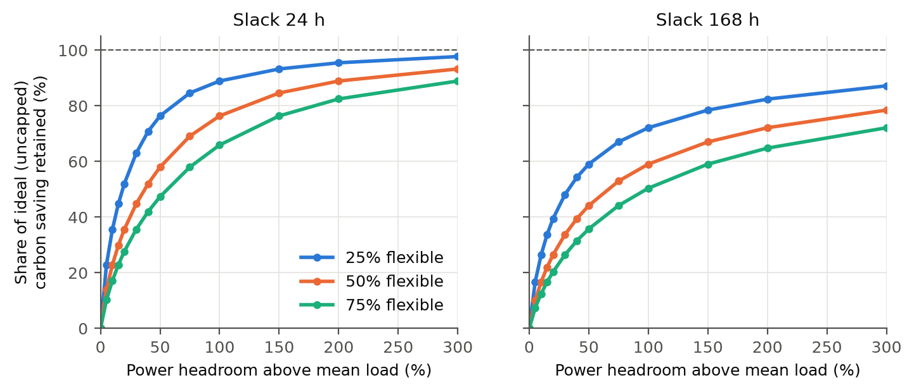

**Forecast error under a cap.** Real schedulers act on forecasts. I optimised schedules on noisy forecasts and charged them the true intensity. The forecasts used autocorrelated (AR(1), rho = 0.9) multiplicative errors calibrated to a target MAPE (`src/carbonshift/forecast.py`; 123 zones, 3 seeds).

| Forecast MAPE | 5% | 10% | 15% | 30% |
|---|---:|---:|---:|---:|
| Saving lost, uncapped (% of saving) | 9% | 23% | 36% | 66% |
| Saving lost, uncapped (% of emissions) | 0.8% | 1.9% | 2.9% | 5.3% |
| Saving lost, +20% headroom (% of saving) | 10% | 23% | 33% | 50% |
| +20% headroom, share of uncapped saving kept | 35% | 36% | 38% | 52% |

**Finding 2b: at realistic forecast quality, the power cap and forecast error compound almost independently.** The capped facility keeps about the same share of the uncapped saving (35-38%) as with perfect forecasts (36%). Only with poor forecasts does the cap act as a hedge: capped schedules spread work over many hours instead of betting on the predicted minimum. The absolute cost of forecast error (0.8-2.9% of emissions at 5-15% MAPE) agrees with the paper's estimate of about 3%.

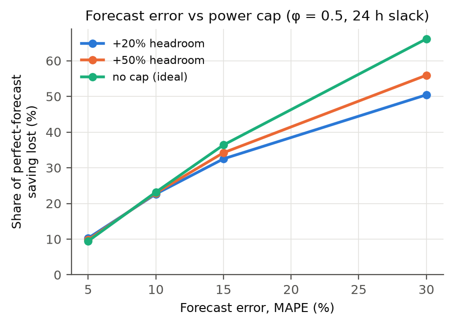

**Real facilities: Google's power traces.** To ground the headroom axis in real data, I used Google's public PowerData2019 traces: 5-minute power utilisation of 57 power domains in May 2019 (CC-BY; Sakalkar et al., ASPLOS 2020).
- **Utilisation:** domains run at a median **70%** of their power capacity (range 52-78%), so real facilities have about **+42% headroom** above mean load.
- **Saving kept:** at each domain's real headroom, carbon shifting keeps a median **54%** of the ideal saving (44-75%; 120 grids, phi = 0.5, 24 h slack).
- **The daily load shape barely matters.** I laid the real hour-of-week shape over every grid at all 24 daily alignments. With the fleet-median shape, the worst alignment (peak on the cleanest hours) loses 1.4% of the saving; with the most diurnal domain (21% daily swing), 5.9%. Averaged over alignments, the result equals the flat-load model, which validates the flat-load simplification used above.

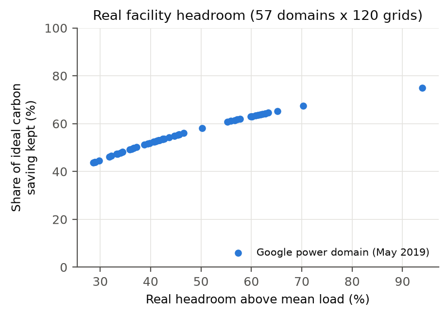

**Finding 3: green, variable grids gain the most from headroom.** South Australia gets 6% from just 5% headroom. India-West has a flat, coal-heavy trace and stays near 5% even with unlimited power.

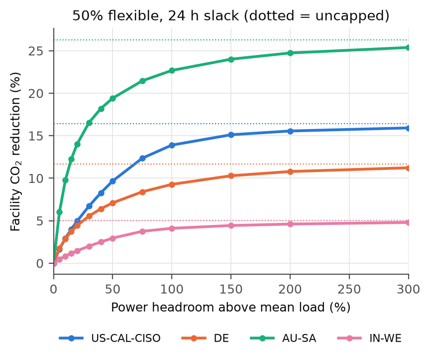

**Finding 4: UPS batteries can't do the job.** A UPS sized for 10 minutes of ride-through, fully cycled once a day with 90% round-trip efficiency, cuts emissions by **0.19% on average** (0.9% in the best zone). Keeping half of it in reserve for ride-through halves that. Even a dedicated 4-hour battery averages 3.5%, less than half-flexible load with 50% headroom (5.4%).

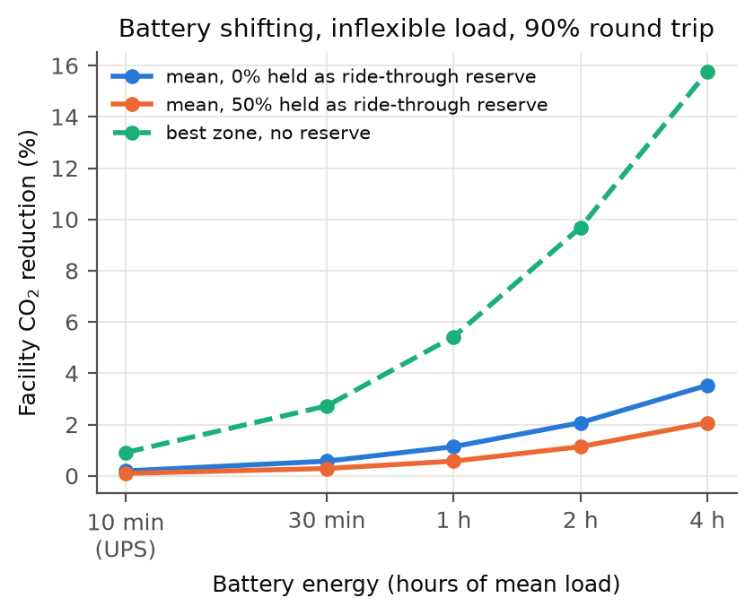

*Update, marginal accounting (Finding 15, Sec. 5).* For battery arbitrage the marginal signal is the right ledger, and there the same UPS is worth about five times more. Section 5 shows this, with the caveat that it does not carry over to the average ledger.

## 4. Extension 2: GPU power vs LLM batch size, measured

AI inference is the fastest-growing flexible load, and batch size is its main efficiency knob. I measured it on real hardware: an Apple M4 Pro (20-core GPU) running MLX 0.32 with two 4-bit Qwen2.5 instruct models (1.5B and 7B).
- **Workload:** B different prompts decoded together, with concurrency forced to B; 128 new tokens each, at least 6 s per point, 3 repeats.
- **Power:** sampled every 100 ms with `macmon`, which reads the same IOReport counters as `powermetrics` but needs no sudo.
- **Headline metric:** chip energy (CPU + GPU + DRAM). Whole-system power drifted upward during the run as the machine warmed, so it is reported as an upper bound only. Raw data: `results/llm_power.csv`.

| Model | Batch | Tokens/s | GPU W | Chip mJ/token |
|---|---:|---:|---:|---:|
| Qwen2.5-1.5B | 1 | 198 | 15.3 | 99 |
| | 8 | 604 | 25.4 | 45 |
| | 32 | 1,292 | 28.5 | **23** |
| | 128 | 1,392 | 30.7 | 23 |
| Qwen2.5-7B | 1 | 53 | 18.2 | 377 |
| | 8 | 149 | 28.4 | 194 |
| | 32 | 318 | 31.2 | **100** |
| | 128 | 326 | 32.1 | 101 |

Throughput repeats agree within about 1%; chip power varies by up to 8% between repeats (7B model, batch 1). Error bars are in the figure.

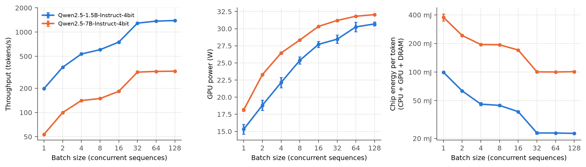

**Finding 5: batching buys throughput far more cheaply than it costs power.** For the 1.5B model, going from batch 1 to batch 32 raises throughput **6.5×** while chip power rises only **1.5×**. Energy per token falls **4.3×**, and **3.8×** for the 7B model.

**Finding 6: the GPU saturates at batch ≈ 32.** Past it, decode throughput rises under 10% (1,616 → 1,770 tokens/s for 1.5B, decode only) and GPU power levels off at 31–32 W. Bigger batches then add queueing delay without adding efficiency. The steps are uneven: 4 → 8 is nearly flat, then 16 → 32 jumps 1.7–1.9×. That pattern suggests a kernel-selection threshold in MLX's quantised matrix multiplication; I have not verified this.

**Link to Extension 1.** On a power-capped facility, the first lever is to run inference at its efficient batch size, which delivers about 4× more tokens per joule within the same watts. Only work beyond the saturation point should be shifted in time, and that shifting is what draws on headroom. In a California-like grid (264 g/kWh mean), the 1.5B model emits about 7.3 g CO₂ per million tokens at batch 1 and 1.7 g at batch 32. That 4× gap exceeds anything temporal shifting achieved in Section 3.

**Does batch size need to follow the grid?** Using the measured curves, each sequence's time per output token is B / throughput(B). Under a yearly mean latency budget, I compared the best *static* batch mix with a *carbon-aware* hourly mix (small, fast batches in clean hours; large, efficient ones in dirty hours). This is solved exactly by Lagrangian bisection (`src/carbonshift/llm_batching.py`; 120 grids, flat demand).

| Model | Latency budget (ms/token) | Static batching vs batch 1 | Carbon-aware vs static (pooled) | Best grid |
|---|---:|---:|---:|---|
| Qwen2.5-1.5B | 6 | -41% | -1.7% | -12% (UY) |
| Qwen2.5-1.5B | 10 | -57% | -2.2% | -17% (UY) |
| Qwen2.5-1.5B | 15 | -64% | -4.7% | -23% (UY) |
| Qwen2.5-1.5B | 20 | -71% | -4.8% | -16% (DK-BHM) |
| Qwen2.5-7B | 25 | -43% | -1.6% | -9% (UY) |
| Qwen2.5-7B | 50 | -56% | -3.6% | -24% (UY) |
| Qwen2.5-7B | 75 | -64% | -4.8% | -18% (DK-BHM) |

**Finding 7b: batch for efficiency first; following the grid is second-order.** The right static batch size saves 41-71%; carbon-aware timing adds 1.6-4.8%, up to 24% only in very variable grids. The curves also show that batch sizes 8 and 16 are dominated: batch 32 halves energy per token for nearly the same latency, so a scheduler should jump straight from small batches to 32.

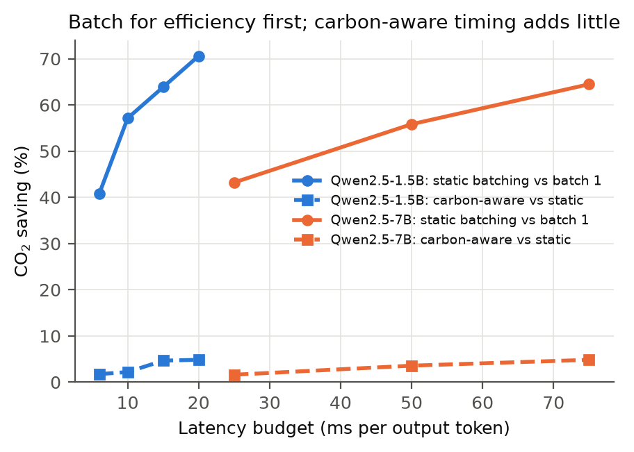

## 5. Extension 3: the carbon price of a kilowatt, and the redundancy dividend

Section 3 showed that headroom limits carbon-aware shifting. Two questions follow: **what is one more kW of headroom worth, and is it worth building?**

**Shadow carbon price of capacity.** The dual variables of the capped LP's hourly power constraints give, for each hour, the grams of CO₂ saved by one more kW of capacity in that hour. They are verified against finite differences in `tests/test_facility.py`. Summed over a year, they give the **annual carbon value of one extra kW of headroom**. With half the load flexible and 24 h slack, the median zone saves:
- **346 kg/yr** at 10% existing headroom;
- **228 kg/yr** at 20%;
- **112 kg/yr** at 50%;
- **48 kg/yr** at 100%.

The 90th-percentile zone saves 2.5–3× more. The value falls steeply as headroom grows: the first kilowatts are worth most.

**What headroom costs to build.** I found no published per-kW embodied-carbon factors for data-centre electrical plant, so I derived them from manufacturer EPDs (A1–A3, `src/carbonshift/embodied.py`):
- **Transformers:** 16.3 kg/kVA (Trafo Elettro 2,500 kVA cast resin) and 7.65 kg/kVA (ABB 16/20 MVA).
- **UPS:** 17–74 kg/kW across three products (ABB MegaFlex, ABB DPA 250, Schneider Galaxy VX).
- **Generator sets:** 53 kg/kVA (Cummins QSK95) and 61 kg/kVA (mtu 10V1600).
- **Servers** (product carbon footprints): Dell R650 and R760 for CPU servers, and the NVIDIA HGX H100 baseboard for GPU servers.

Sheddable, deferrable work doesn't need UPS or generator backup, because on a grid outage it is postponed, not lost. So the cheapest headroom for carbon shifting is **grid-only** capacity (transformer + switchgear, about 28 kg/kW). Fully backed capacity costs about 150 kg/kW.

| Headroom build (median zone, 20% existing headroom, 24 h slack) | Embodied kg/kW | Payback | Zones that pay back within service life* |
|---|---:|---:|---:|
| Grid-only electrical (25-yr life) | 28 | **0.1 yr** | 98% |
| Fully backed electrical (25-yr life) | 150 | 0.7 yr | 94% |
| GPU servers (5-yr life) | ~470 | 2.1 yr | 79% |
| CPU servers (5-yr life) | ~2,000 | 8.8 yr | **23%** |

\*With savings shrinking 3%/yr as grids decarbonise.

**Finding 7: build power, not servers.** Extra electrical capacity for carbon shifting repays its embodied carbon within months in almost every zone. Buying CPU servers just to absorb shifted work fails to pay back within a server's life in more than three-quarters of zones. Carbon-aware shifting is therefore worth doing with **idle compute that already exists**, and a power-constrained operator gains most from electrical headroom, not from more servers. The server factors rest on an assumed average draw (0.35 kW per CPU server; a full GPU server at twice the baseboard), and are flagged as assumptions in the code.

**Is this robust to the embodied-carbon uncertainty?** I re-ran the payback 5,000 times, drawing every component from its EPD range, CPU-server draw from 0.25-0.5 kW, the GPU full-server multiplier from 1.5-3x, lifetimes (electrical 20-30 years, servers 4-6) and a 0-5%/yr decline in savings (`scripts/embodied_uncertainty.py`). The ordering CPU servers < GPU servers ≤ backed ≤ grid-only electrical held in **100% of draws**. At +20% headroom, electrical builds repay in 92-98% of zones in every draw. CPU servers repay in a median 23% (90% interval 1-52%), and a majority of zones repays in only 5% of draws. At +50% headroom, CPU servers almost never pay back (median 2%) and GPU servers are a coin flip (median 50%).

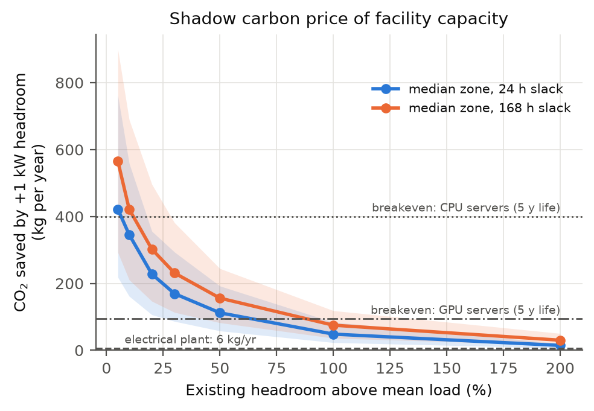

**The redundancy dividend.** Tier-rated facilities already own idle electrical capacity: the spare module in N+1, or the whole second path in 2N. Microsoft's Flex (ISCA'21) showed this reserve can host sheddable work and be reclaimed within seconds when a failure occurs. I apply that idea to carbon: put deferrable work on the redundant capacity, and fall back to design capacity during maintenance (2 × 24 h per year) and random failures (0.5 per year, 8 h mean repair).

Results at 65% design utilisation, mean over 123 zones, with half the load flexible and 24 h slack:

| Capacity available to flexible work | Facility CO₂ reduction | Gap to ideal (8.8%) closed |
|---|---:|---:|
| Design capacity only | 5.5% | – |
| + N+1 spare (N = 4) | 6.7% | 36% |
| + 2N spare | 7.9% | 73% |

**Finding 8: redundancy is free carbon headroom, and outages barely matter.** Maintenance and failures cost less than 0.01 percentage points: the dividend survives outages almost intact, and it adds no embodied carbon. Scheduling maintenance in the hours with the lowest shadow price recovers 90–100% of that tiny loss. The effect is real but negligible, an honest negative result for carbon-aware maintenance scheduling.

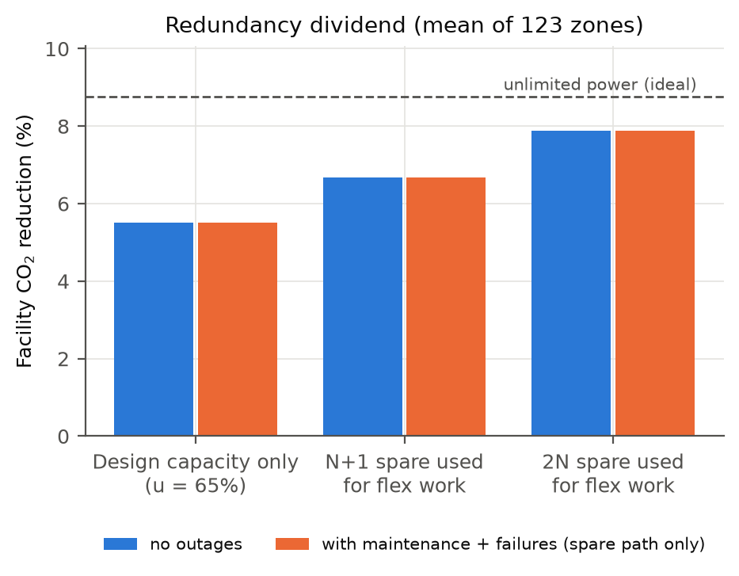

**Robustness across years.** The facility findings are not an artefact of 2022 (`scripts/robustness_years.py`; phi = 0.5, 24 h slack, the 120 zones with non-constant traces).

| Metric | 2020 | 2021 | 2022 |
|---|---:|---:|---:|
| Share of ideal kept, +20% headroom | 36.7% | 36.0% | 35.6% |
| Share of ideal kept, +50% headroom | 58.7% | 58.0% | 58.0% |
| Shadow price of capacity, median (kg/kW-yr) | 198 | 217 | 232 |
| CPU servers repaid within life | 15% | 18% | 23% |
| Gap closed by N+1 / 2N | 35% / 72% | 35% / 72% | 36% / 73% |

Per-zone shadow prices rank-correlate at Spearman 0.93-0.97 between years, so a zone that values capacity highly in one year does so in the next. **Finding 9: the carbon value of capacity is rising.** The median shadow price grew 17% from 2020 to 2022. Three years is too short to call it a trend, but it runs opposite to the paper's observation that the *relative* benefit of carbon-aware scheduling shrinks as grids get greener. As variability grows, headroom becomes worth more.

**Where should the next kW go?** Take a cloud's real regions: the 32 GCP regions whose grids are in the dataset, with measured inter-region latency. Give every region a facility at Google's real 70% utilisation, with half its load flexible. Two shadow prices of capacity follow:
- **spatial:** the annual dual of each region's capacity in an hourly migration LP under a latency limit (`src/carbonshift/spatial_capacity.py`);
- **temporal:** the dual from the capped time-shifting LP.

| | 50 ms | 100 ms | 250 ms |
|---|---:|---:|---:|
| Fleet CO₂ reduction from migration | 14.2% | 18.5% | 21.2% |
| Top-3 regions by spatial value | CA-QC, CA-ON, US-NW-PACW | CA-QC, CA-ON, FR | CA-QC, CA-ON, FR |
| Spearman: spatial value vs mean CI | -0.61 | -0.84 | -0.97 |
| Spearman: spatial vs temporal value | -0.15 | -0.39 | -0.22 |

**Finding 10: spatial and temporal flexibility want capacity in different places.** One extra kW in Quebec is worth 2,943 kg CO₂/yr as a migration destination (100 ms), 22x the median temporal value of 137 kg, yet only 1.5 kg for time shifting because its grid is flat. The best temporal sites (AU-NSW, US-NW-NEVP, US-NW-PACE) are dirty, variable grids that are nearly worthless as migration destinations. Where migration is allowed, siting for carbon means building where the grid is clean. Where data must stay put (latency, residency), it means building where the grid is variable. **Caveat:** this uses average intensity, as the paper does. Extra load in a hydro-exporting region such as Quebec can displace exports, so its marginal emissions may be far higher than its 28 g/kWh average.

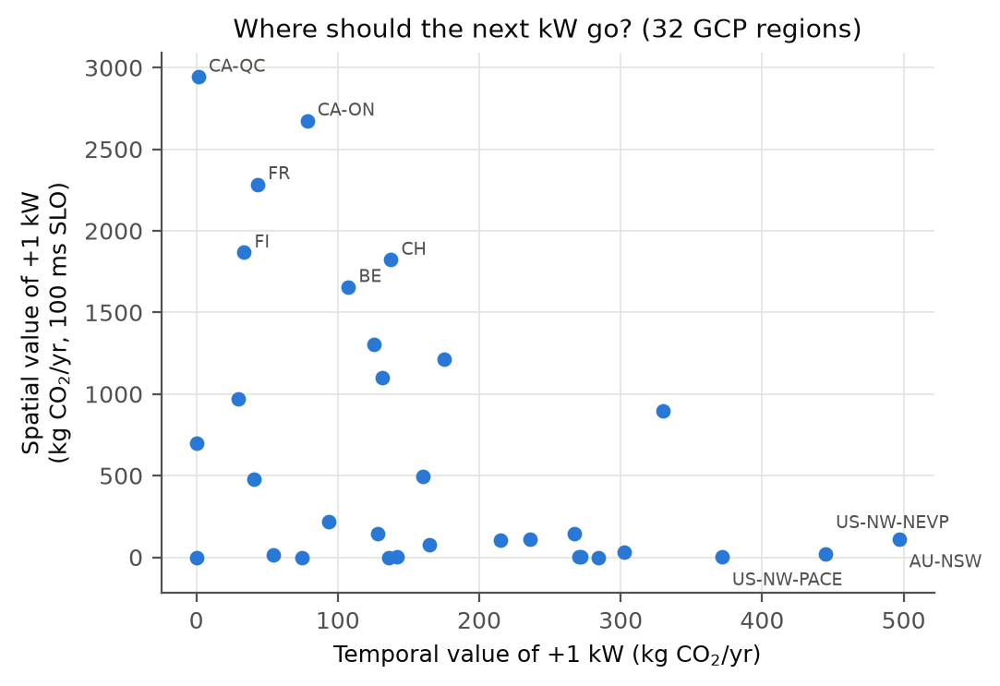

**What drives the value of capacity? Swing, not level.** In the capped LP, the total work served is fixed and the constraints don't depend on carbon intensity. So for any transform ci' = a + b·ci (b > 0) the optimal schedule is unchanged, and savings and shadow prices scale exactly by b (tested). The *level* of intensity is irrelevant; only its *absolute* swings matter. The data agree (120 zones, 2020-2022):

| Statistic of the grid | Spearman with value of +1 kW (2022) |
|---|---:|
| Daily standard deviation, g/kWh (absolute swing) | **0.993** |
| Mean intensity | 0.55 |
| Daily coefficient of variation (relative swing, the paper's indicator) | 0.48 |

**Finding 11: one public statistic predicts the carbon value of capacity.** Value ≈ 4.83 × (daily std)^1.12 kg CO₂ per kW-year (R² = 0.96). A grid with a 30 g/kWh daily swing gives about 219 kg/kW-yr, so an operator can estimate capacity value without solving an optimisation. It also explains the rising value in the robustness check: from 2020 to 2022 the change in value follows the change in swing (ρ = 0.97), not the change in mean (ρ = -0.01). The median swing grew 15%. **Decarbonisation raises the value of capacity only if it widens swings** (solar and wind); decarbonising with steady sources (nuclear, hydro) lowers it.

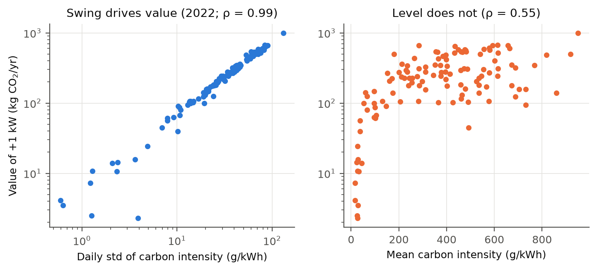

**Do the findings survive a marginal signal?** Average intensity, used throughout, is what the GHG Protocol reports, but shifting load changes *marginal* emissions. I built both signals for 48 US balancing authorities from EIA-930 hourly generation by fuel (`src/carbonshift/eia930.py`). The average is generation-weighted lifecycle factors; it matches Electricity Maps at r = 0.91 (annual means) and 0.88 (hourly). The marginal signal is a Siler-Evans regression of hourly emission changes on generation changes, per season and hour of day.

| Question | Result |
|---|---|
| Swing law (value tracks daily std) under marginal signals | ρ = 0.96 (vs mean: 0.16), **holds** |
| Average-optimised capped schedule, scored in marginal emissions | gets 7% of the marginal-optimal saving (median 1.5%); **raises** marginal emissions in 44% of BAs |
| Siting rank by mean intensity, average vs marginal | ρ = 0.78; reversals such as SRP and DUK |

**Finding 12: the signal choice matters more than the cap.** The structural results (the swing law; clean grids as destinations) survive, but a scheduler tuned to average intensity achieves almost none of the marginal reduction and often increases it. This extends Sukprasert et al. (2024) to power-capped facilities. The marginal factors here are coarse (season × hour bins), so part of their larger swing is estimation noise.

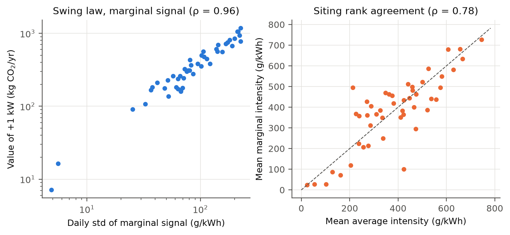

**Do spatial and temporal flexibility add up?** I extended the cumulative-flow LP to many regions. Each origin's flexible work must still finish within its slack, but in any hour it can run in any region within the latency limit, subject to that region's capacity. The LP is tested to reduce exactly to temporal-only and spatial-only shifting. I solved it for the European and the US GCP regions (100 ms, 24 h slack, 2022, monthly blocks).

| Group, headroom | Temporal alone | Spatial alone | Joint | Temporal's extra on top of spatial |
|---|---:|---:|---:|---:|
| Europe, real (1/0.70) | 5.4% | 24.4% | 25.2% | +0.8 pp |
| Europe, unlimited | 9.4% | 35.9% | 38.9% | +3.0 pp |
| US, real (1/0.70) | 5.1% | 13.4% | 14.1% | +0.7 pp |
| US, unlimited | 9.2% | 28.1% | 34.8% | +6.7 pp |

**Finding 13: under real power caps, the two flexibilities compete for the same headroom.** Migration fills the clean regions' spare capacity, which leaves no room there for time shifting. With Google-real headroom, temporal shifting keeps only 14-15% of its standalone value once migration is allowed; with unlimited capacity it still adds 3-7 pp. For a cloud whose work can migrate, headroom in clean regions is the binding resource, and investing in temporal flexibility pays off mainly for work that cannot move.

**Can one schedule serve both signals?** Finding 12 leaves an operator who reports average emissions but wants to cut marginal ones with a dilemma. I scheduled each BA on the blend w × average + (1 − w) × marginal and scored the result on both signals (`src/carbonshift/hedge.py`; same cap and slack as above). Since the LP is linear, sweeping w traces the Pareto frontier.

| Weight on average, w | 0 | 0.3 | 0.5 | 0.7 | 0.9 | 1 |
|---|---:|---:|---:|---:|---:|---:|
| Share of average optimum kept | 6% | 38% | 58% | **78%** | 96% | 100% |
| Share of marginal optimum kept | 100% | 98% | 92% | **79%** | 46% | 7% |

**Finding 14: hedging is nearly free.** The frontier is strongly concave. Each pure schedule gets 6-7% of the other signal's saving and makes it worse in 43-47% of BAs, but a small weight on the other signal recovers much of it: w = 0.9 gives up 4% of the average saving to lift the marginal one from 7% to 46%. Per BA, the best balanced weight keeps a median 73% of both optima. The reason is that each signal leaves many hours nearly tied, and the other signal breaks those ties at little cost. Schedulers should not pick one signal; they should blend them. The result holds out of sample (marginal factors estimated on even days, scored on odd days, and vice versa): w = 0.7 then keeps 76% of the average optimum and 82% of what the marginal-only plan achieves on held-out days. Blending is not, however, a useful regulariser for the noisy marginal signal: the held-out marginal saving peaks at w = 0 when pooled.

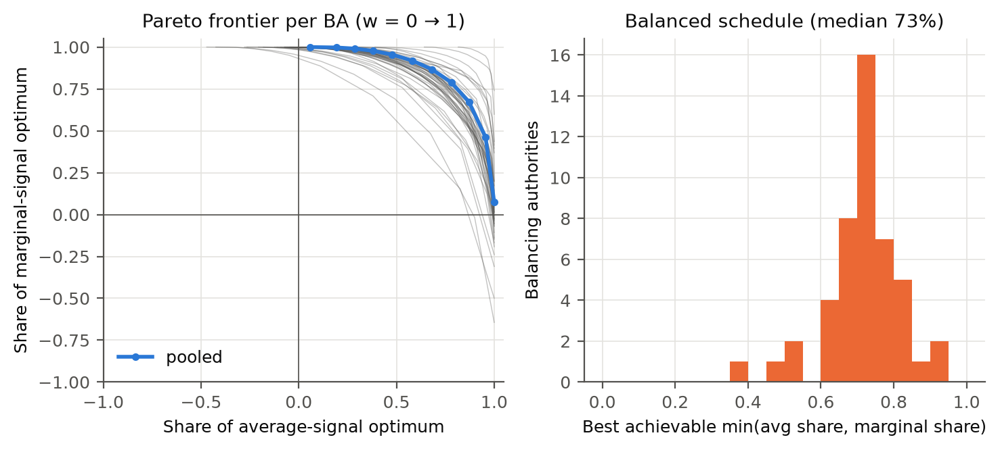

**Batteries under a marginal signal.** A battery's arbitrage is pure incremental load, so marginal accounting is the natural ledger for it. The marginal factors are regression estimates, though: 14 of 53 BAs have negative bins, and an arbitrage LP will exploit noise. So I re-estimated them on even and on odd days separately, dispatched on one half and scored on the other (48 BAs, 90% round trip, median reduction).

| | 10-min UPS | 1 h | 4 h | Capped shifting (F17 setting) |
|---|---:|---:|---:|---:|
| Average signal, dispatched on average | 0.10% | 0.60% | 1.9% | n/a |
| Marginal signal, in-sample | 1.2% | 7.0% | 12.3% | 8.4% |
| Marginal signal, **out-of-sample** | **0.50%** | **3.0%** | **6.2%** | **5.8%** |
| Out-of-sample share of in-sample (pooled) | 51% | 52% | 65% | 74% |

**Finding 15: on the marginal ledger a UPS is worth ~5x more, but storage cannot serve both ledgers.** Dispatching on the average signal raises marginal emissions in 81% of BAs, and dispatching on the marginal signal raises average-ledger emissions in 98%. Unlike load shifting, blending (w = 0.7) does not reconcile them: it still raises the average ledger in 42-65% of BAs. The reason is round-trip loss: every cycle draws more energy than it returns, so a cycle that the average signal did not choose is a net cost on the average ledger. The noise check also shows that the marginal-signal savings above (Finding 12, 14) are upper bounds by roughly a quarter.

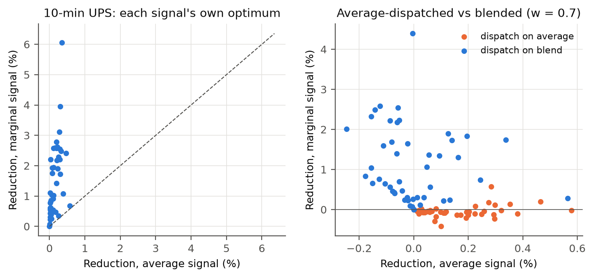

**Related work and novelty.** Google's Carbon-Intelligent Compute System caps flexible capacity hour by hour with virtual capacity curves (Radovanović et al., 2021), and the UMass group studies contention when many jobs pick the same low-carbon window (CarbonFlex 2025; Hanafy et al. 2026). Flex (Zhang et al., ISCA 2021) reclaims reserved power to deploy more servers. I have not found prior work that does any of the following:
1. derives the shadow carbon price of facility capacity across many grids;
2. compares it with EPD-based embodied carbon of electrical plant and servers;
3. uses tier redundancy as carbon-shifting headroom.

## 5b. A closed-form law for all of the above

The headroom curve (Finding 1), the 13x peak, the value of a kW and the swing law were all computed with an LP. They follow from one picture. With 24 h slack, a day's flexible work (24 φ units) runs at its maximum rate φ + h in the day's cleanest hours, like water filling the lowest parts of the price curve. That gives four closed forms (`src/carbonshift/waterfill.py`), each tested against the LP results (`scripts/waterfill_experiments.py`):

| Law | Formula | Against the LP |
|---|---|---|
| Homogeneity theorem | share kept depends only on **h / φ** | exact: max difference 0.0000 over 1,200 zone-level pairs |
| Uncapped saving | φ · A, where A = mean daily (mean − min) | R² 0.998 |
| Capped saving | **φ · A · sinc(π φ / (φ + h))** | R² 0.968 over 4,680 LP solves; median error 0.9% |
| Value of +1 kW | daily area between the "water level" and the cheaper filled hours | R² 0.981 over 360 zone-years; median ratio 1.002 |
| Peak draw, uncapped | 1 + slack · φ | exact (7x, 13x, 19x for φ = 0.25, 0.5, 0.75) |

**Finding 16: one formula explains the facility results.** *Headroom per unit of flexible load* is the only variable that matters for the share kept: +20% headroom with half the load flexible behaves exactly like +10% with a quarter flexible. The sinc curve gives the shape: half the ideal survives at h ≈ 0.8 φ. For a sinusoidal day the value of a kW is π A q² |sinc′(π q)| with q = φ / (φ + h). It is linear in the daily amplitude A and blind to the mean, which *derives* the swing law found empirically in Finding 10. In practice an operator can estimate both the saving and the value of new capacity from one sort of each day's prices, with no optimiser.

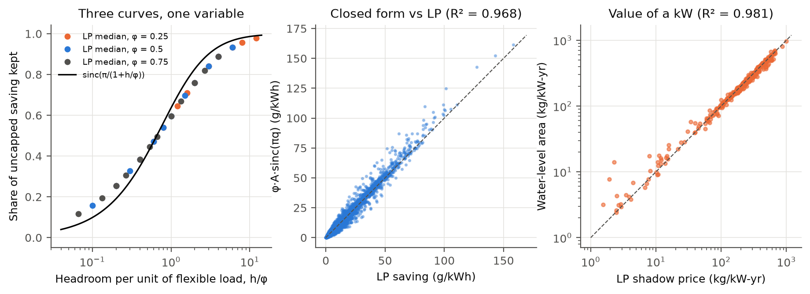

**Finding 17: flexible load under a power cap *is* a lossless battery.** Write the backlog of deferred work as B = arrivals − served. The cumulative-flow constraints then read 0 ≤ B ≤ s·φ (nothing waits longer than the slack) and −h ≤ ΔB ≤ φ (you cannot defer more than arrives, or catch up faster than the headroom allows). That is a battery of energy **s·φ**, discharge power **φ**, charge power **h** and **100% efficiency**: deferring work "discharges" it, catching up "recharges" it. The LPs agree to a median 0.14% on real grids; they differ only in their boundary condition. Three earlier puzzles follow:

| Puzzle | Explanation from the virtual battery |
|---|---|
| Fixed-block water-filling underestimates at tight caps (−38% at +5% headroom) | The battery refills in s·φ/h hours, so tight caps plan over *longer* than the slack (10 days at +5%). Water-filling over that horizon cuts the bias to −4.6% (24 h slack) and −1.6% (168 h) |
| A 10-minute UPS saves only 0.19% (Finding 4) | Half-flexible load with 24 h slack is a 12-hour lossless battery: 72× the UPS's energy, with no losses |
| Blending signals works for load (Finding 14) but not for UPS batteries (Finding 15) | Losses, not storage, are the obstacle: a *lossless* 1 h battery dispatched on the 0.7 blend worsens neither ledger in any of 48 BAs, while at 90% round trip it worsens the average ledger in 60% |

The last row was a prediction made from the theorem before running the test.

**Finding 18: the storage exchange rate. A kW of headroom for flexible work replaces several kWh of real batteries, for 1/8 to 1/55 of their embodied carbon.** The virtual battery is lossless and free; a real one is not. To price the difference, I compared every zone's capped-shifting saving (the LP above) with a grid-scale Li-ion battery: 4 h duration, 90% round trip, cyclic, optimally dispatched on the same signal (one LP per zone, 123 zones, 2022). The battery's saving per kWh obeys its own closed form, a daily *spread law*: charge in each day's 4 cleanest hours, discharge in the 4 dirtiest, skip days whose spread does not cover the losses (R² 0.993 against the LP, median ratio 0.999).

| Facility (φ = 0.5, 24 h slack) | +5% | +10% | +20% | +50% | no cap |
|---|---|---|---|---|---|
| Battery kWh with the same saving, per kW of mean load (median) | 1.9 | 3.0 | 4.3 | 6.8 | 11.0 |
| Battery embodied carbon ÷ headroom embodied carbon (median) | 55× | 42× | 31× | 19× | — |
| Same, most battery-favourable zone and factors | 22× | 19× | 16× | 8.4× | — |

The exchange rate inherits the homogeneity theorem: X / (24φ) = κ_zone × retention(h/φ), so φ = 0.25 at +5% gives exactly the same per-virtual-kWh rate as φ = 0.5 at +10% (0.248). With no cap, one virtual kWh is worth κ = 0.91 real kWh (median; interquartile 0.78-1.44). In 7 of 123 zones the daily spread never covers 10% losses, so a battery saves nothing while flexible load still does. Chaining the two closed forms (water-filling over the effective horizon ÷ spread law) predicts the LP exchange rate with log-R² 0.91 and a median ratio of 0.94, with no optimiser at all.

**Across years.** Re-running on 2020 and 2021 (120 zones, φ = 0.5, 24 h slack), the median exchange rate at +20% headroom is 4.9, 4.8 and 4.3 kWh/kW for 2020, 2021 and 2022 (12.6, 12.4 and 11.0 uncapped). Zone rankings are stable (Spearman 0.85-0.95 between years), and last year's rate predicts this year's within 25% for 78-84% of zones (median error 9%). The spread law holds every year (R² 0.993-0.994). The slow decline means batteries gained slightly on flexibility as daily spreads widened.

Caveats: embodied factors are LFP 54-69 kg CO2eq/kWh (secondary source) against grid-only headroom (transformer + switchgear, 18-38 kg/kW); batteries also sell grid services this comparison ignores, and their shorter life (about 15 years vs 25) would widen the gap further.

## 5c. Beyond one facility: when carbon-aware computing saturates

Every result above, and the literature it builds on, treats the grid signal as fixed: one more kWh in a clean hour costs that hour's intensity, however many kWh arrive. That cannot hold as data-centre load grows.

**First check: can a herd push up the marginal rate?** I fitted an emissions supply curve, E = a + b·F + c·F², to each U.S. balancing authority and season (EIA-930 2022, 44 BAs, 176 BA-seasons; F = fossil output). The marginal rate dE/dF changes by a median of only 6.6% between low-output and high-output hours (10th vs 90th percentile), and it rises in only 46% of cases. Fossil fleets have no consistent upward slope, so a herd cannot defeat itself by climbing the merit order.

**What is finite is curtailment.** The one supply that is truly zero-carbon at the margin is renewable energy that would otherwise be thrown away. A new fleet of mean load P drawing L_t in hour t emits m·max(0, L_t − C_t), where C_t is the energy curtailed that hour and m = 490 g/kWh for the gas-fired margin. This cost is convex, so a coordinated fleet solves an LP. A *herd* of facilities, each optimising alone on an exogenous signal (average intensity, or 'free when curtailed'), is scored on the same cost. Data: CAISO 5-minute production and curtailment data for 2021-2024 (1.5, 2.4, 2.7 and 3.4 TWh curtailed). Half of the load is flexible, with 24 h slack.

**Finding 19: carbon-aware shifting saturates at about a gigawatt in California, and without a power cap herding makes it backfire.**

| CAISO 2022, new fleet of mean load | 0.1 GW | 0.5 GW | 1 GW | 2 GW | 4 GW | 8 GW |
|---|---|---|---|---|---|---|
| Saving per flexible kWh, coordinated, +20% cap (g) | 51 | 23 | 15 | 8 | 2 | 0 |
| Avoided per year, coordinated, uncapped (kt CO2) | 96 | 229 | 316 | 273 | 57 | 0 |
| Avoided per year, herd, uncapped (kt CO2) | 26 | −2 | −59 | −120 | −135 | −41 |
| Avoided per year, herd = coordinated, +20% cap (kt CO2) | 22 | 50 | 66 | 70 | 32 | 0 |

1. **Saturation.** Per flexible kWh, the saving falls by two-thirds between 0.1 and 1 GW and reaches zero near 8 GW. At that size the fleet absorbs nearly all curtailment just by running, so carbon-awareness adds nothing. Total avoided emissions are hump-shaped in fleet size and peak at 0.5-2 GW in every year (2021: 38 kt at +20% headroom; 2024: 106 kt). For scale, data centres used 4.4% of U.S. electricity in 2023 (LBNL); the same share of CAISO's 25.7 GW mean load is about 1.1 GW.
2. **Uncapped herding backfires.** The uncapped schedule is the paper-style upper bound. Each facility puts its flexible work into the single cleanest hour, a 13× peak (F21). The herd overflows that hour's curtailment and abandons the curtailed hours it would have used by running on arrival. From 0.5 GW (2021-2023) or 1 GW (2024) upward it raises emissions, by up to 71 kt (2021), 135 kt (2022), 120 kt (2023) and 198 kt (2024) per year.
3. **A power cap is an anti-herding device.** With +20% or +50% headroom, the uncoordinated herd achieves 97-100% of the coordinated optimum at every fleet size in all four years. The constraint that limits one facility's saving (Section 3) is what keeps a fleet of them safe. This is not a theorem: a made-up case in the tests shows a capped herd can still overflow small, scattered curtailment, though far less than an uncapped one.
4. **The theory still holds.** Daily water-filling against curtailment, absorbed = min(Σ min(C_t, cap), Σ min(C_t, 1−φ) + 24φ) per day, matches the coordinated LP within 5% (ratio 0.95-1.003 in all 84 cases).

*Sensitivity.* With EIA-930's CISO season × hour marginal factors in place of a constant margin, savings no longer saturate, and the coordinated saving even rises with fleet size. That is exactly the artefact of treating the signal as exogenous: an hour-of-day factor does not know how much clean energy is left. The uncapped herd still captures only 4-26% of the coordinated saving, against 45-72% with a cap.

*Limitations.* The margin is a constant gas rate; imports, hydro and storage dispatch would also respond to new load. Curtailment is taken as observed, though a fleet that shows up would change future curtailment and solar build-out. The fleet is a single new load at CAISO scale, with no transmission limits inside CAISO.

## 5d. The power meter as a side channel

**Finding 20: carbon-aware scheduling is visible on the power meter within a week, and the meter reads out the virtual battery.** With hourly draw d scaled to mean 1, the carbon saved against a flat draw is exactly −cov(c, d) (verified to 10⁻¹¹ g/kWh). So no facility can save carbon without a matching negative covariance between its meter and the public carbon signal. Anyone who sees the meter (the utility, a co-located tenant, an inspector with a clamp meter) and the public signal can test for it.

Setup: 960 simulated facilities on 40 Electricity Maps zones (φ 0.1-0.5, slack 12-24 h, headroom +20-50%) and 1% meter noise. Inflexible load is either flat or a real Google power-domain shape, with day-to-day variability bootstrapped from the May 2019 traces. The observer correlates hour-of-day residuals of meter and signal. An ordinary busy-by-day load that happens to line up with a solar grid is therefore *not* flagged (tested).

| Scheduler (Google load) | AUC, 7 days | 30 days | 90 days | Saving kept |
|---|---|---|---|---|
| Real-time carbon signal | 0.92 | 0.96 | 0.99 | 100% |
| Signal + noise (σ = ½ signal std) | 0.84 | 0.91 | 0.97 | 78% |
| Monthly time-of-day profile | 0.52 | 0.61 | 0.74 | 70% |

- **Dithering does not hide it.** Random noise in the schedule costs 22% of the saving and still leaves AUC ≥ 0.84 after one week.
- **A time-of-day schedule does.** Scheduling on each month's average carbon by hour is indistinguishable from ordinary load for two weeks (AUC 0.52). It is only weakly detectable after 90 days, through month-to-month profile changes, and keeps 70% of the saving. It responds to the predictable part of the grid's cycle and ignores day-to-day weather, which is exactly the part the detector sees.
- **The meter reveals the operator's parameters.** By the virtual-battery theorem (F22), cumsum(1 − d) is the backlog of deferred work. On flat load, 30 days of meter data give the flexible share within 0.015 (all facilities classified correctly), the headroom within 0.025, the virtual battery energy s·φ within 5% (median), and the slack (12 vs 24 h) correctly for 97% of facilities. With real Google load the absolute values are biased, but the flexible shares are still ordered perfectly over a year, and slack is right for 86-87%.

Why it matters: the flexible share and slack describe an operator's workload mix and its customers' deadlines. Carbon-aware scheduling as usually built broadcasts them. Power side channels in data centres are known (e.g. power attacks on oversubscribed facilities), and non-intrusive load monitoring is a mature field; I found no prior work on detecting carbon-awareness, or inferring its parameters, from a facility meter. *Limitations:* simulated facilities with fluid work; an observer with hourly data and the same public signal; no adversarial operator strategies beyond the three tested.

## 5e. The cooling penalty

**Finding 21: carbon-aware schedulers overstate their savings because clean hours are hot, and a closed-form law says where.** A facility draws IT power × PUE, and PUE rises with outdoor temperature because chillers lose efficiency as the heat-rejection temperature climbs. So the carbon cost of an IT kWh is c(t)·PUE(t). Extending F25's identity, the true saving of a draw d (mean 1) is −cov(c·PUE, d), while an operator who multiplies a carbon-only saving by the annual PUE claims −mean(PUE)·cov(c, d). The gap is the *cooling penalty*.

Setup: the 47 Electricity Maps zones that host cloud regions, each with hourly 2022 dry- and wet-bulb temperature at one data-centre hub (Open-Meteo / ERA5, UTC). Two first-principles cooling archetypes: *hyperscale* (warm 18 °C chilled water, cooling tower on wet bulb, water-side economiser; annual PUE median 1.09) and *legacy* (7 °C chilled water, air-cooled condenser on dry bulb, no economiser; median 1.40). Facility as in Section 3: flat IT load, φ ∈ {0.25, 0.5}, slack 24 h, IT headroom +20%, +50% or uncapped.

- **Clean hours are hot.** In 72% of zones the mean daily profiles of carbon and PUE are anti-correlated (ρ < −0.3): solar makes midday both clean and hot.
- **The claim is too high.** Pooled over zones, the carbon-only scheduler's claimed saving exceeds its true saving by 2.2-2.7% (hyperscale) and 6.9-8.3% (legacy). The median zone loses 1.5-1.8% and 4.2-5.0%. The tail is heavy: in 13 of 47 zones a legacy plant loses over 10% of the claim, up to 61% in Singapore, 45% in Johannesburg and 42% in Mumbai.
- **A closed-form law predicts it.** If the schedule moves against the carbon signal, penalty / claim ≈ −ρ · (c̄ / σ_c) · (σ_PUE / P̄), with ρ and the σs of within-day (25 h detrended) hourly variation. Against the LP: R² 0.77-0.98, Spearman 0.83-0.98 across the 12 configurations, median ratio 0.98-1.29. The factor c̄/σ_c is the inverse of the carbon signal's coefficient of variation, so the penalty is largest on dirty grids with a small relative swing (Singapore, Mumbai, Johannesburg). This is the regime where F15 found CV a poor guide to capacity value; here CV is exactly the right indicator.
- **Scheduling on c·PUE recovers part of it, and works where carbon cannot.** The cooling-aware schedule saves 0.5-1.4% (hyperscale) and 2.5-3.6% (legacy) more true carbon pooled; in Singapore (legacy) it raises the true saving 2.5-fold. On the flat-signal grids of Hong Kong and Jakarta, where carbon-only scheduling saves nothing, weather alone saves up to 1.0 (hyperscale) and 3.6 g/kWh (legacy).

Novelty: cooling-aware workload management is established for single sites with on-site renewables (Liu et al., SIGMETRICS 2012, who plan around outside-air cooling and solar). I found no measurement of how much grid-carbon-aware schedulers overstate their savings by ignoring PUE variation, across real grids and weather, nor a closed form for it. *Limitations:* steady-state hourly cooling model with assumed parameters (two archetypes bracket the range); one hub per zone; PUE independent of IT load (fixed losses would make it fall with load); no thermal storage or lag. Outputs: `results/cooling_*.csv`, `figures/cooling.png`.

## 6. Takeaways

1. The EuroSys'24 temporal upper bounds are also **power** upper bounds: reaching them assumes a facility can draw many times its average load. A useful practical bound is the **saving-vs-headroom curve**, which depends on the electrical design.
2. Headroom is the real currency. Stranded power capacity is common because facilities are provisioned for peak and redundancy. Carbon-aware schedulers should treat the *remaining electrical headroom* as the scarce resource. The marginal gram saved per extra kW of headroom falls steeply after about 50%.
3. The headroom curve sets operational savings against **embodied carbon and cost** of extra electrical plant. That trade-off connects to Ecovisor's idea of exposing power and energy to applications, and to CarbonScaler's elasticity.

## 7. Limitations

- Grid **average** carbon intensity is used, as in the paper. Marginal intensity can change conclusions.
- Forecasts are perfect. The paper estimates about a 3% loss at CarbonCast-level errors.
- Inflexible load is flat in the main model. Google's real load shapes change the result by at most 1.4% (fleet median) to 5.9% (most diurnal domain) of the saving, even in the worst alignment (Section 3).
- Flexible work is modelled as fluid and pre-emptible; long, non-parallel jobs would retain less. Migration and checkpoint overheads are ignored.
- Batteries are charged at grid average intensity, and degradation and the embodied carbon of extra headroom are not counted.
- The embodied factors come from a small number of EPDs: one or two per component, and switchgear has none. Server factors rest on assumed average power draws. The redundancy model treats failures as fleet-average events and ignores partial-module failures and cooling redundancy.
- The GPU numbers come from one laptop-class Apple chip running two small 4-bit models. They show the shape of the batch curve, not data-centre accelerator numbers. Background apps were running during the measurement, which is why whole-system power is reported only as an upper bound.

## 8. Next steps

1. Use a real facility load shape and per-cluster power caps, such as the Google power-trace data, in place of the flat base load.
2. Add a joint spatial-temporal model in which each region has its own power cap, so that low-carbon regions saturate.
3. Make the trade-off explicit: the embodied carbon of extra transformer, UPS and generator capacity against the operational carbon saved, giving a carbon-optimal headroom.
4. Model facility-aware control in an Ecovisor-style virtual energy system that exposes "power budget" alongside "carbon signal" to applications.
5. Repeat the batch-size study on a data-centre GPU (an A100 or H100 with `nvidia-smi` power capping), adding a power-cap sweep. The question is whether "batch first, then shift" holds when the chip itself is capped.

## 9. Interactive explorer

`carbonshift-web` serves a small app for experimenting with every model in this report: pick a grid region and slide the job length, slack, flexible share, power headroom, battery size or LLM batch, and the results update live. See the README for its security design.

## Reproducing

```bash
python3 -m venv .venv && .venv/bin/pip install -e ".[dev]"
.venv/bin/python -m pytest              # 84 tests
.venv/bin/python scripts/reproduce.py   # ~20 s; results/repro_*.csv, figures/repro_*.png
.venv/bin/python scripts/facility_experiments.py  # ~80 s; results/facility_*.csv, figures/facility_*.png
.venv/bin/python scripts/llm_power_batch.py       # ~20 min, Apple Silicon + `brew install macmon`
.venv/bin/python scripts/redundancy_experiments.py # ~2 min; shadow prices, embodied payback, redundancy dividend
```
